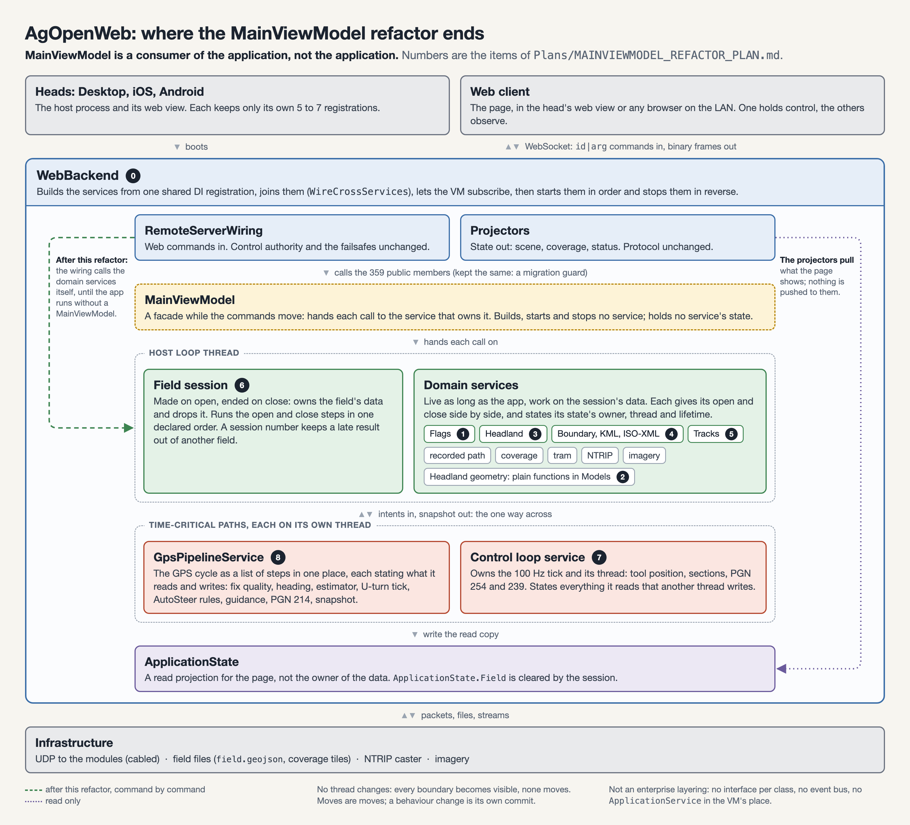

# MainViewModel refactor plan

**Status:** Agreed 26 Nov 2026: all items, under a total change freeze in early December 2026,
before R1. Done by chriskinal and Claude. The GPS cycle (item 8) was added the same day. See
[Decided](#decided). Revised after Richard's review (#961, 26 Nov): a target, the rules sorted
into requirements and migration guards, startup and service lifetimes out of the VM, a field
session that owns field state, a merge on the pass mark, not on a date, and the dead code removed
ahead of the freeze as its own PR. The total freeze stays. A second pass against the code added:
the startup order stated and its own round, the field lifecycle in two stages, a busy-field
lifecycle test still to write, a move script, thread checks, a rehearsal, and thirty days, not 26.

The whole plan in one picture, from today's problems through the steps to where it ends:
[MAINVIEWMODEL_REFACTOR_MIGRATION.png](MAINVIEWMODEL_REFACTOR_MIGRATION.png).

## Why

Not for elegance. The goal is code a person can review: a change to steering, sections, the GPS
cycle or a field's open and close can be judged from its diff, without reading the rest of
MainViewModel. Human review is the bottleneck, and the VM's shape is what makes it slow and
unreliable:

- **Review.** A change to the core file can't be judged from its diff: the file is 6,617 lines,
  with 314 private fields across the partials, a 460-line constructor and 53 event subscriptions.
  The code that most needs careful review is the hardest to find: the 100 Hz loop that moves the
  tool, decides the sections and sends PGN 254 and 239 (`OnControlLoopTicked`) is in the core
  file, and which VM fields it reads, from which thread, is visible nowhere. That's why #953 could
  not be taken on unit tests and a green build.
- **Field open and close.** What a field sets up is cleared somewhere else (`ClearFieldState`, an
  85-line list in the core file), and nothing ties the two together: whoever adds a feature has to
  remember the list, and the reviewer has to notice when they didn't. Since October six fixes were
  for something left behind after closing a field: the NTRIP connection (#286), the imagery
  (#309), coverage and tram lines (#310), a boundary recording (#625), the sections (#749), the
  recorded path (#956).
- **The GPS cycle.** `GpsPipelineService.ProcessCycle` is one method of about 1,100 lines, run
  on the pipeline's worker thread for every fix: it takes in the host loop's commands, judges the
  fix, fuses the heading, works out the antenna and reversing, feeds the pose estimator, ticks the
  U-turn state machine, applies the AutoSteer on and off rules, runs the guidance, the light bar,
  the headland, lift and tram lights, sends PGN 214 and builds the snapshot the VM reads. The
  class has 98 fields every step can read and write, and the order of the steps is nowhere but in
  the method. Of the 52 PRs that touched the file since October, 42 were fixes. It is the code
  that steers, and a change in one step can't be judged without reading all of it.
- **Merge conflicts.** Of the PRs merged between v26.7.7 and v26.7.8 (19 to 26 Nov 2026), 14
  touched MainViewModel and 10 of them the core file. Three of those 10 changed the same two
  places, the constructor and `StartHelloTimerAsync`, because every new feature is started there.
- **Dead surface.** About 211 public members (182 of them commands) are declared and never used:
  what's left of the Avalonia dialogs, removed in October. They make the file look larger and more
  tangled than it is, and a reader can't tell live code from dead.

## What was tried before

| When | What | Outcome |
|---|---|---|
| Dec 2025 | `STATE_CENTRALIZATION_PLAN.md`: every field into an `ApplicationState`, the VM to ~500 lines, in one sweep | Not done as written. Too big to do while the app kept changing |
| Jan 2026 | `MAINVIEWMODEL_REFACTORING_PLAN.md`: code moved into partial files unchanged | Done in two days. Merge conflicts fell, but a partial is the same class: the core file is back from ~1,500 to 6,617 lines, and the coupling is unchanged |
| Apr 2026 | U-turn logic moved out of the VM into services, in five phases (#256) | Worked: `YouTurnStateMachine`, the pass book-keeping and the path creation are services with their own tests, and the U-turn work since then has been made there |

The lesson: moving code into partial files does not hold, and a big sweep does not get done.
What holds is taking one domain at a time out into a service with its own tests, as #256 did.
This plan does that for the whole VM, and for the GPS cycle the VM feeds, under a freeze.

## Where it ends

**MainViewModel is a consumer of the application, not the application** (Richard, #961). The
backend starts, runs and stops its services; the VM is what the web commands call while they are
moved, and holds no service's life or state. AgOpenGPS's `FormGPS` became the app by the same
road, one feature at a time, with classes all round it.

```
 heads (Desktop, iOS, Android)         the host process and its web view
      |
 WebBackend                            builds the services (DI), starts and stops them in order
      |
 RemoteServerWiring, projectors        the web commands in, state out (protocol unchanged)
      |
 MainViewModel                         a facade while the commands move; no lifetimes, no state
      |
 field session    domain services      flags, headland, boundary, tracks, ... (state per session)
 GpsPipelineService   control loop     the time-critical paths, each on its own thread
      |
 ApplicationState                      a read projection for the page, not the owner of the data
      |
 UDP, files, NTRIP, imagery            infrastructure
```

As a diagram, with the plan's item numbers, the threads and the two links the sketch can't show
(the projectors pulling from `ApplicationState`, and the wiring calling the domain services itself
after this refactor):



Not an enterprise layering: no interface per class, no event bus, no `ApplicationService` that
takes the VM's place. Geometry stays plain functions; the GPS cycle stays a list of direct calls.

What this refactor reaches, and what is left for after it:

| Outcome | This refactor | After |
|---|---|---|
| The VM does not build, start or stop services | Yes (item 0) | |
| Each extracted domain states its state's owner, writer, thread and lifetime | Yes (every item) | |
| Field state lives in a field session, and a result can't land in another field | Yes (item 6) | |
| The control loop and the GPS cycle each readable and testable on their own | Yes (items 7, 8) | |
| A new feature does not need to touch the VM | For the extracted domains | The rest as commands move |
| `RemoteServerWiring` calls the domain services, not the VM | No: the surface is kept as a migration guard | Command by command, keeping control authority |
| The app runs without a MainViewModel | No | The goal once the wiring has moved |
| Fewer statics (`ApplicationState.Instance`, `ConfigurationStore.Instance`) | New services take theirs by injection | The old users |

## Scope

Nothing in the VM is out of scope. The VM stays as what `RemoteServerWiring` calls, and hands
each call to the service that owns it. The order and the scope are set by gain and risk, not by
open PRs: the enhancement PRs open now will be delivered in thematic phases and reworked at that
time anyway, so they are not a reason to leave anything out or to shape it differently.

| # | Domain | Where it is now | Size | Notes |
|---|---|---|---|---|
| 0 | Startup and lifetimes | the 460-line constructor and `StartHelloTimerAsync`; the three heads' DI | - | See below |
| 1 | Flags | core 2668-3033 | ~360 | Richard's `FieldFlags` (#953) may be used as the start where it fits; it does not set the design |
| 2 | Headland geometry | core 5413-6340 (`ClipHeadlandAtLine`, `LineSegmentIntersectsLine`, `CalculateHeading`, `CalculatePathLength`, ...) | ~900 | Pure geometry: to Models beside `GeometryMath`, on the geometry and numbers it is given, not the open field or the config. Tests of what valid output is, not only that it matches: a bow-tie, duplicate and very close points, near-parallel lines, either winding, a hole |
| 3 | Headland builder state | `MainViewModel.Headland.cs`, `Headland.Remote.cs`, core 4059-4290 | ~1,600 | After 2. Three owners, not one builder service: the field's headland (saved, per session), the editing session with its undo (while the builder is open), the preview (drawing only) |
| 4 | Boundary list, KML and ISO-XML import | core 4759-5382 | ~620 | File parsing out of the VM |
| 5 | Track persistence | core 2820-3033, 6377-6531 | ~370 | Load, save, migrate; `Commands.Track.cs` stays |
| 6 | Field lifecycle | `OpenFieldCoreAsync` (core 1695-1990), `CloseFieldAsync`, `ClearFieldState` (core 2137-2221), the save methods | ~600 | See below. Needs 1-5 first: they provide their open and close steps |
| 7 | Control path | `OnControlLoopTicked`, `OnRenderPullTick` (core 638-785), `GpsHandling.cs`, `SectionControl.cs`, `Guidance.cs`, the AutoSteer handlers (core 1306-1456) | ~1,200 | See below. With extra checks |
| 8 | GPS cycle | `GpsPipelineService.ProcessCycle` (Services, about 1,100 lines in one method; the class 2,673) | ~1,100 | See below. Last: the same path as 7 and the same seam (`Sync*ToPipeline`, the snapshot the VM reads), checked by the same tests |

### Startup and lifetimes (0)

Today the VM is part of the composition root: its constructor takes 45 services, starts
AutoSteer, the GPS pipeline and the control loop, and joins services to each other through casts
to their classes (`AutoSteerService.SetTramLineService`, `SetToolPositionService`,
`SetSmartWasService`). The heads register the VM as transient while it starts singletons.

- **The backend owns startup and shutdown.** `WebBackend` starts the services in today's order and
  stops them in reverse, each with a start and a stop it owns; the VM's constructor only
  subscribes to what it shows. The order is the same, so this is a move, checked by the same tests.
- **The order, stated:** everything is built, the VM subscribes, then the backend starts the
  services. Today the constructor subscribes to the GPS, AutoSteer and cycle events before it
  starts AutoSteer, the pipeline and the control loop (core 411-438); a service started before
  the VM exists would send its first events to nobody.
- **Services are joined where they are built**, through what they declare (constructor or a stated
  setter on the interface), not by a cast in the VM. `WebBackend.WireCrossServices` already joins
  UDP to AutoSteer this way; the three casts go there.
- **The VM is a singleton,** as the backend already uses it.
- **A service is registered once,** in a shared registration all three heads call, so the heads
  keep only what is theirs (of the 59 to 60 registrations in each head today, all but 5 to 7 are
  the same line). A test builds the shared container and resolves the backend: the first test of
  the real graph, as every VM test today uses a builder of stand-ins.
- **Its own round,** tested on all three heads on a device before items 1-5 start: a startup
  fault shows per platform (Android's foreground service, iOS's launch), not in a unit test.
- Each feature's own start (`StartModuleLostWatch()`, `StartDataQuality()`, ...) is one call in
  that order, not a block in the middle of the constructor.
- Written down for each service as it moves: what happens on a start that fails part way, on a
  second start or stop, and who removes the event subscriptions (`BackendStateLease` came from
  a stopped backend kept alive by them).

### Field lifecycle (6)

The bug to design out is a step done on open, or during work, that is not undone on close.

- **A field session owns the field's state.** Opening a field makes a session; closing it ends the
  session and drops what it held. The domain services live as long as the app and work on the
  session's data, so nothing field-specific outlives its field by forgetting a reset.
- **In two stages, because the second is not a move:**
  1. *The steps move.* What `OpenFieldCoreAsync` and `ClearFieldState` do goes into the session,
     in the same order: a move, reviewed as one (rule 1).
  2. *The data changes owner.* The field data that leaves the VM with items 1-5 (the flags, the
     headland segments and the builder's undo, the boundary list, the tracks) goes into a
     per-session object, made on open and dropped on close; each domain's reset of it goes. Each
     domain is its own commit, a design change read as one, held by the lifecycle test.
  `ApplicationState.Field` stays one object for the app's life, cleared by the session
  (`FieldState.Reset`): the page's projectors read it, and it is the read copy, not the owner.
- **Each domain gives its open and close side by side** (flags, headland, boundary, tracks, recorded
  path, coverage, tram, NTRIP, imagery), for what does need undoing outside the session (a
  connection, a module output). A missing close is seen next to its open.
- **The session runs the steps in one declared order,** in one short file, with the reason for
  each place in it (AutoSteer off first; the recorded path ended before the sections go off,
  #956). The order is read in review, not dug out of a method.
- **Same steps, same order as today.** The session runs what `OpenFieldCoreAsync` and
  `ClearFieldState` run now.
- **A result can't land in another field.** Each session has a number; work started for one field
  (imagery capture, an import, a save) carries it, and its result is dropped if another session is
  open when it comes back. Today the boundary imagery capture can: started in field A, it is saved
  into field B if B was opened meanwhile (`ApplyCapturedBackground` checks only that a field is
  open). This is a behaviour change, made as an allowed fix (rule 2) with its own test.
- **The states and the overlaps are stated:** closed, opening, open, closing; what a second open or
  close does, and a command arriving during one, as today (the host loop runs one at a time, but an
  `await` lets another command in between). Changes to them are fixes, made under rule 2.
- **A test of the whole cycle** (written before the freeze, against today's code): open a field,
  use every feature, close it, check that every domain reports nothing left; open another field,
  check that nothing of the first shows. A domain cannot join the session without a close step,
  so a new feature is covered by the test without anyone remembering it. The test as merged
  (#964) does not do this yet: see Phase 1.

### Control path (7)

The algorithms are already services (`TrackGuidanceService`, `SectionControlService`, the U-turn
services, the GPS pipeline); what is in the VM is the glue: the 100 Hz tick, the 30 Hz render
pull, the GPS cycle and its `Sync*ToPipeline` steps, the section bar and the remote switches.

- **A control loop service owns the tick and its thread.** It states which thread it runs on and
  everything it reads that another thread writes, in one place. The VM sets its configuration
  through it and does not reach into it.
- **No thread changes.** What runs on the loop's thread, the host loop or the module's data
  thread today runs there after. The boundary becomes visible; it does not move. #957 showed how
  a change of thread breaks things tests rarely catch.
- **Why it is safe to move:** it is the best-tested code we have. The Vehicle & Tool sweep flips
  every setting and checks the steer angle, the PGNs and the sections; the job harnesses measure
  where product went on a 0.2 m grid; the machine module harness reads every PGN; the working day
  times every control tick; the hot-path budgets count the work in each cycle.
- **Extra checks for this step:** the working day's tick timings and its total allocated, the full
  sweep and the machine module's PGN counts, each within the spread of the two baseline nights.

### GPS cycle (8)

The same flaw as the field's open and close: the order of the steps is implicit, and every step
shares every field.

- **Each step its own method or class,** with what it reads and what it writes stated: the
  intents, the fix quality, the heading, the antenna and reversing, the estimator, the U-turn
  tick, the AutoSteer rules, the guidance, the light bar, the headland and lift, PGN 214, the
  snapshot.
- **The cycle is the list of steps** in today's order, in one place, with the reason for each
  place where the order matters (the U-turn tick before the guidance that steers along the turn).
- **Same steps, same order, same thread.** The cycle stays on the pipeline's worker thread; the
  intents stay the one way in from the host loop and the snapshot the one way out.
- **Hot path.** No allocation added: a step passes what it works out in fields of the cycle or in
  structs, not in new objects per fix. The GPS cycle's `WorkCounters` budget and the working
  day's total allocated (about 18.4 GB a night) are checked against F.
- **Extra checks for this step:** the control path's, and the job harnesses' pass order, turns
  and area sprayed, and the Vehicle & Tool sweep's steer angles, each within F's spread.

### Rules for the refactor branch

Two kinds, kept apart (Richard, #961): what must hold during and after the refactor, and the
guards that keep the move reviewable, which are for the migration and are not the architecture.

**Requirements, for good:**

- Steering, sections, the lift and the PGNs act as they do; no field data lost or changed.
- The web protocol, control authority (`ControlAuthority`, the observer list) and the failsafes
  (AutoSteer and sections off when control ends) stay as they are, whichever class a command
  reaches.
- Timing: the control tick and the GPS cycle do no new work per tick (no allocation, no blocking,
  no UI notification on those paths).
- All three heads run the same shared code.

**Migration guards, for this refactor:**

1. **Moves are moves.** Moved code is not edited, apart from the calls into the new service. Each
   domain is one commit (the field lifecycle, the control path and the GPS cycle a few), so
   `git diff --color-moved` shows what changed beyond the move. A script (`Tools/`, written before
   the freeze) lists, for a commit, every added line that is not a copy of a removed one: that
   list is what a person reviews, and it is posted with each round.
2. **A behaviour change is its own commit,** with a test that fails before it, and is named in the
   round's review. Allowed only when the move needs it, or when it is about safety or data (the
   imagery result above). Other bugs found are written down and fixed after the merge. A known
   unsafe behaviour is never kept to match F.
3. **The wiring's surface stays the same** while the commands still go through the VM: the 359
   public VM members the wiring, the web host, the heads, the tests and the simulators use keep
   their names, types and behaviour (`MainViewModelSurfaceTests`). The test is a migration guard:
   a member goes from it when its command moves to a domain service, after this refactor.
4. **Threads stay as they are.** Every service states in its header the thread that owns its
   state, who may read it from where, and how a change crosses (a copy, a snapshot, an intent). A
   cross-thread read found wrong is a rule 2 fix, not kept because it is today's. The statement is
   also checked: an extracted service asserts its owning thread where its state is written
   (`IUiDispatcher.CheckAccess` for the host loop), in debug and test builds only, so the unit
   tests and the harnesses fail on a call from the wrong thread. Not on the control tick or the
   GPS cycle in a release build.
5. **Hot-path budgets: no more work.** A `WorkCounters` count that rises fails; one that falls is
   explained in the round's review and the budget lowered.
6. **Services are built by DI,** never by the VM (item 0).
7. **No new statics.** A new service takes its config and state by injection, not through
   `ConfigurationStore.Instance` or `ApplicationState.Instance`.

## Dead code removal (before the freeze)

The ~211 public members nothing uses, and the private fields and methods only they used. Found
by: declared in the VM, not named in `RemoteWiring`, `RemoteServer`, `Platforms`, `Tests` or
`Simulators`, and named no more than twice in the ViewModels and Services projects. Each is
checked by hand before it goes (a hotkey or a name built at run time would not show in a search).
The same sweep covers `ConfigurationViewModel` (1,849 lines) and `AutoSteerConfigViewModel`
(1,053), which are still used but date from the Avalonia panels too.

It goes in before the freeze as its own PR (Richard, #961): members removed, nothing moved, so it
is reviewed on its own, and the refactor's diffs are smaller for it. It passes CI, the
characterization tests and the surface test unchanged (a removed member is one nothing uses, so
it was never in the surface list), and a nightly on develop after it is merged.

## Phase 1: before the freeze

1. **Announce the freeze** to the contributors at least a week ahead, with its dates: nothing is
   merged to develop while it lasts. Contributors may keep working on their branches. Open PRs are
   not waited for: bug fixes ready before the freeze are merged, the rest are rebased after it.
2. **Characterization tests** for each domain, written against develop and merged before the
   freeze. They drive the VM through its public members and check the results, so they pass
   unchanged before and after:
   - flags, headland, boundary and import, tracks (`DomainCharacterizationTests`, #964): each
     domain driven through the members the web commands call, 13 to 16 steps with the field closed
     and reopened between them (flags placed, renamed, recoloured, deleted; headlands made from the
     boundary and from map points, offset, renamed, toggled, deleted; boundaries selected, made
     drive-through, deleted, KML imported with one polygon and a bow-tie; tracks selected,
     activated, renamed, swapped, nudged, deleted). After each step, what changed in the VM and a
     digest of the field's files is recorded and compared with today's;
   - field lifecycle (`FieldLifecycleCharacterizationTests`, #964): every public property of the VM
     and its `State` read (`VmStateReader`) before a field is opened and after it is used and
     closed, and what of field A shows when B is opened after it. No list kept by hand: a new
     property is covered by itself. It found #965 (the headland distance carried over to the next
     field), fixed before the freeze.
     **Still to do before the freeze:** the test opens a field, activates a track and places two
     flags, on a VM whose coverage, section, recording, tram, NTRIP and job services are
     stand-ins. It would not have caught the six bugs this plan starts from. A second, busy field
     with the real services: a job started, sections on, a path and a boundary being recorded,
     tram lines, a headland, NTRIP connected, imagery; then close, and the services' own state is
     read as well as the VM's. Its proof: each of the six fixes (#286, #309, #310, #625, #749,
     #956) undone in turn, and the test failing each time;
   - control path: **dropped.** A replayed GPS run through the VM's 100 Hz tick, which runs on a
     real timer, could only be compared within a spread, and what it would have checked is held
     elsewhere: the GPS cycle test below
     drives the guidance, U-turns, sections and lift fix by fix on a clock the test moves, and the
     harnesses (the Vehicle & Tool sweep, the machine module's PGNs, the working day's tick
     timings) carry the tick itself, within F's spread (step 7's extra checks);
   - GPS cycle (`GpsCycleCharacterizationTests`, #963): five whole drives (AB and curve, normal and
     skip worked, alternate on a half-worked field without a headland), closed loop, through the
     real cycle on a clock the test moves (`Clock.Set`), every fix's result recorded and compared
     with today's: pose, tool, AutoSteer, guidance, U-turn, sections, lift, messages. The cycle's
     own wall-clock reads are only in its performance diagnostics, so no app change is needed.
   - Not in these tests: the ISO-XML import, the AgOpenGPS migration and the short A+ line. Their
     code is in services that do not move, and has its own tests (`InteropImportTests`,
     `LegacyFieldMigrationServiceTests`, `ShortABLineTests`).
3. **The surface test** (`MainViewModelSurfaceTests`): a list of the public VM members the rest of
   the app uses (from reflection), checked in. The test fails when one is added, removed or changes type. It is updated on purpose after
   the refactor if a change is wanted, never as a side effect.
4. **The dead code removal** (above) and the fix for #969 (the imagery result), each its own PR.
5. **The move script** (rule 1), tried on the rehearsal.
6. **A rehearsal:** item 2 (the headland geometry: pure, the most independent) done on a throwaway
   branch through one whole round: the move, the move script's list, the tests, all eleven
   harnesses against develop on the harness host. It times a round and finds what is wrong with
   the tooling while a day lost costs nobody a frozen develop. The branch is not merged; the
   schedule below is corrected from what it shows.

## Phase 2: the freeze

The steps, and the problem each takes out, are drawn in
[MAINVIEWMODEL_REFACTOR_MIGRATION.png](MAINVIEWMODEL_REFACTOR_MIGRATION.png).

| Day | Step |
|---|---|
| 1 | Freeze starts at commit **F** on develop. Total change freeze: nothing is merged to develop until the merge |
| 1-2 | **Testing before:** CI, the hot-path budgets, and the full nightly set on F on two nights: the second night shows the noise (on 25 and 26 Nov the finding codes matched and only timings and counts moved, e.g. a turn at 139.8 s against 139.5 s). The nightly keeps running on F every night of the freeze, so the baseline's spread grows with it. Manual check on hardware (below) |
| 3-4 | **Refactor, round 1:** startup and lifetimes (0) |
| 5 | **Testing round 1:** CI, the hot-path budgets, the characterization and surface tests, all eleven harnesses as whole runs (no `TURNS` or `ONLY`) against F with `runner-compare.sh` on the harness host, and the manual check on all three heads |
| 6-9 | Fixes from round 1. **Refactor, round 2:** items 1-5, one commit each |
| 10 | **Testing round 2:** the same set, against F |
| 11-14 | Fixes from round 2. **Refactor, round 3:** the field lifecycle (6), its two stages |
| 15 | **Testing round 3:** the same set, against F |
| 16-18 | Fixes from round 3. **Refactor, round 4:** the control path (7) |
| 19 | **Testing round 4:** the same set, with the control path's extra checks, and the manual check |
| 20-24 | Fixes from round 4. **Refactor, round 5:** the GPS cycle (8), a step at a time |
| 25 | **Testing round 5:** the same set, with the GPS cycle's extra checks, and the manual check |
| 26-28 | **Fixes** for what the refactor broke, each with a unit test made from the finding |
| 29 | **Testing again:** the whole set and the manual check |
| 30 | **Merge and unfreeze**, if the pass mark is met |

About thirty days, four more than first agreed: the review added the startup work as a round of
its own and the second stage of the field lifecycle. The rehearsal (Phase 1) corrects these
numbers before the freeze is announced. Each round is tested on its own, so a finding points at
one round's commits, and the riskiest work comes last, on a base already tested.

**The merge is on the pass mark, not on day 30.** If a round does not pass by then, the rounds
that did are merged and the rest waits (each round is its own commits on top of the one before,
so the branch can be cut after any of them), or the freeze is extended, chriskinal's call. The
last numbered release before F stays the one to go back to; the first release after the merge
goes out as a beta for at least a week of use in the field before it is numbered. Field files
are not changed by the refactor, so going back to the earlier release needs nothing done to them.

### Pass mark (every testing round)

- CI green, the hot-path budgets and the surface test unchanged.
- Every harness: no finding new **and no finding gone** against F. A finding that disappears also
  means behaviour changed, and needs explaining before the merge (a rule 2 fix explains itself).
- The outcomes in [Where it ends](#where-it-ends) marked for this refactor are met for the items in
  the round, read in review: who owns each moved state, on which thread, for how long.
- Measured values (area sprayed, turns, pass order, tick timings, PGN counts) within the spread F
  showed across its two nights.
- The manual check passes on the Desktop head and one tablet (rounds 4 and 5, and the last), and
  on all three heads after round 1.

### Manual check on hardware

Short, the same before and after, done by whoever has the bench:

open a field and start a job; make an AB line; AutoSteer on the bench and off; sections Auto and
manual; build a headland, clip it, undo; place, rename and delete flags; import a KML boundary;
record and play a path; a U-turn on the simulator; NTRIP connected; save, close the field and
check nothing is left (map, sections, recorded path, NTRIP as configured); open another field;
reopen the first; a bug report dump.

## Phase 3: after the merge

- **Open PRs.** Bug fix PRs touching MainViewModel are rebased on the merge (by their author, or
  by us if the author agrees) and reviewed again in full, with the usual recipe. Enhancement PRs
  are reworked onto the new structure when their thematic phase comes, and reviewed then. #953 is
  closed in favour of domain 1, with Richard credited for what was used.
- **CLAUDE.md and `Docs/ARCHITECTURE.md`:** the target above, the new services, the thread each
  runs on, the field session and its order, and the rules that a feature's field state lives in
  the session and that a new feature does not add to MainViewModel.
- **The next steps** toward the target, each its own plan and PR, not frozen: the web commands
  moved from the VM to the domain services a group at a time (control authority kept), until the
  app runs without a MainViewModel; the statics left; and these, raised in #961, each looked at
  against today's code first: config read as one consistent set per GPS cycle and control tick,
  what the host loop does when work comes faster than it runs, which part owns the response to
  each fault (GPS gone, a module silent, a service throwing), and what two screens or the page and
  a background task do when they change the same thing.
- **The nightly** on develop the morning after is the last check; anything new in it is a
  refactor bug until shown otherwise.
- This plan moves to `Plans/Completed/` with what was done and what was learned.

## Decided

Agreed 26 Nov 2026:

1. **Scope:** all items, in one freeze: 0-7 as first agreed, and the GPS cycle (8), added the same
   day, which made the freeze about four weeks; about thirty days after the review's additions.
2. **When:** early December 2026. The start date is set when the freeze is announced, at least a
   week ahead; the characterization tests, the surface test and the dead code removal are merged
   before it.
3. **During the freeze:** nothing is merged to develop. Total change freeze. Kept after Richard
   proposed staged integration (#961): a PR merged while the code under it is moving has to be
   fixed onto code that has changed, and the bugs it brings have to be told apart from the
   refactor's. Each one also stops the refactor: review it, get it fixed or fix it, test the fix,
   merge it. A total freeze keeps the work and the testing on one thing. Contributors are told a
   week ahead and keep working on their branches; their PRs are rebased after the merge.
4. **Who:** Claude does the refactor, the tests and the harness runs; chriskinal reviews each round
   and does the manual check on hardware.
5. **Dead code:** first agreed as the first commit of round 1; after Richard's review (#961),
   removed ahead of the freeze as its own PR instead (see [Dead code removal](#dead-code-removal-before-the-freeze)).
